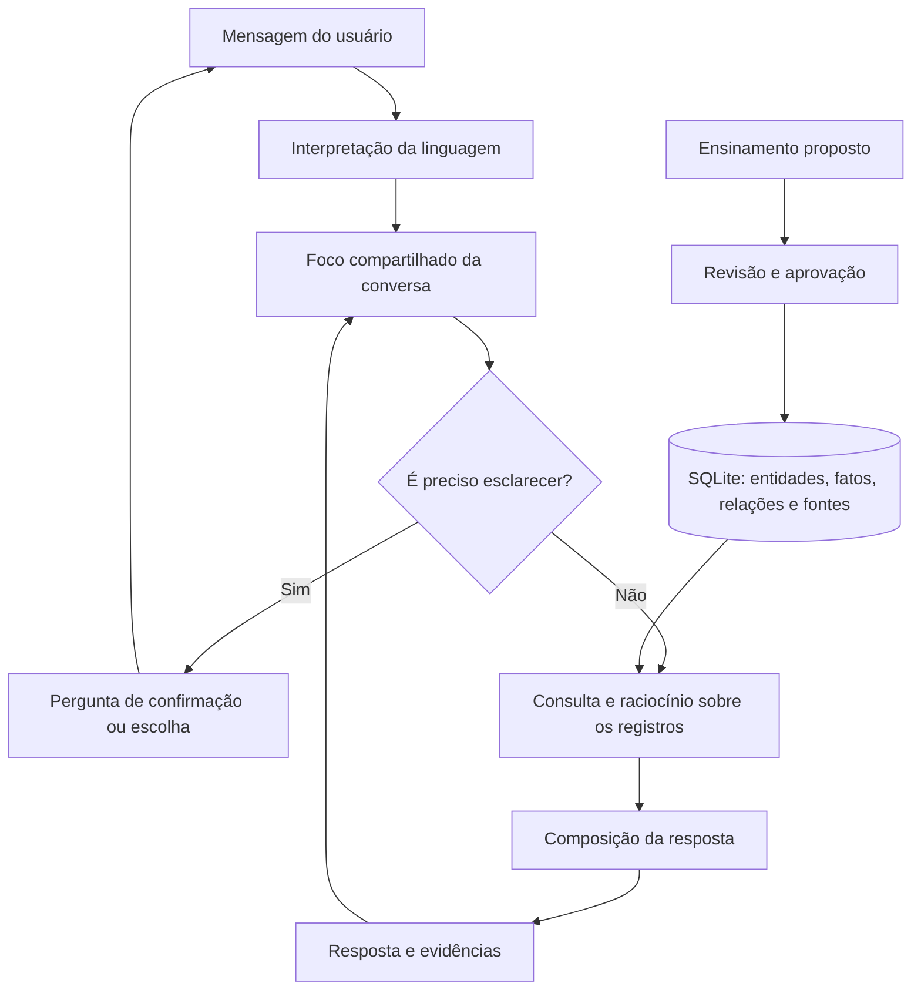
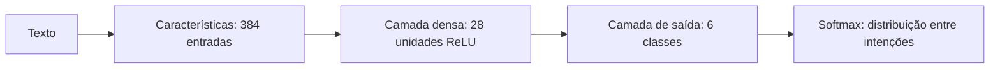

# MylittlIA

**LABORATÓRIO DE LLM EXPERIMENTAL (Little Language Model)**

O MylittlIA é um laboratório educacional para explorar como um sistema de inteligência artificial recebe texto, identifica informações, consulta conhecimentos, acompanha uma conversa e constrói respostas. A proposta é tornar essas operações visíveis: experimentar, ensinar, inspecionar os resultados e entender os limites de cada mecanismo.

O nome **Little Language Model** expressa essa proposta de experimentação em pequena escala. A implementação combina conhecimentos estruturados, regras de linguagem, operações de consulta e pequenas redes neurais treinadas localmente. Não implementa um grande modelo de linguagem nem uma arquitetura Transformer completa.

## Para que serve

- Observar o caminho entre uma mensagem e uma resposta, com entradas, saídas e explicações das etapas.
- Experimentar tokenização, representação vetorial, classificação de intenção e geração de texto.
- Ensinar informações, revisar propostas de aprendizado e consultar conhecimentos aprovados.
- Explorar entidades, nomes alternativos, propriedades, relações e evidências em uma base local.
- Testar continuidade de conversa, correção ortográfica com confirmação e comparações entre registros.
- Estudar a diferença entre cadastrar um fato, interpretar uma pergunta e treinar os pesos de uma rede neural.

É um ambiente de estudo e desenvolvimento. A qualidade das respostas depende dos dados disponíveis, das estruturas de linguagem reconhecidas e dos limites dos modelos implementados.

## Como funciona

A arquitetura é híbrida. No fluxo de conversa, o sistema interpreta a mensagem, combina as informações com o foco atual e busca uma resposta nos conhecimentos e operações disponíveis. Os experimentos de geração neural possuem seus próprios modelos e treinamento.



O núcleo reutiliza mecanismos de identidade, propriedades, relações e foco entre diferentes assuntos. As classes de conhecimento, como cidades, animais ou clubes, são representadas nos dados; não é necessário criar uma classe JavaScript para cada tópico do mundo. Há também adaptadores específicos, como o de futebol, para integrar dados e formatos desse domínio.

### Conhecimento e identidade

Uma entidade pode ter um identificador estável e nomes alternativos. Assim, abreviações e formas de mencionar um mesmo assunto podem ser resolvidas para a mesma identidade, considerando o contexto.

Os fatos e as relações permitem representar propriedades, pertencimento a classes, localização, valores numéricos, fontes e períodos. Entidades relacionadas continuam distintas: Pernambuco e a bandeira de Pernambuco, por exemplo, podem estar ligadas sem serem tratadas como a mesma coisa.

As respostas factuais da conversa são compostas a partir de registros e regras explícitas. Os geradores neurais experimentais não são a fonte geral dessas respostas.

### Contexto da conversa

O gerenciamento compartilhado do foco acompanha informações como entidade ou classe, localidade, propriedade, quantidade, ordenação, operação e período. Uma continuação pode alterar parte desse foco e preservar as demais informações quando houver suporte para isso.

Exemplos de interações exploradas pelo laboratório:

- “E os menores?” — altera a direção da comparação.
- “Mostre cinco.” — altera a quantidade solicitada.
- “Agora por receita.” — propõe outro critério.
- “E de Pernambuco?” — altera o recorte geográfico.
- “Por quê?” — solicita uma justificativa relacionada ao assunto em discussão.

A interpretação depende dos mecanismos e dados existentes. Quando não consegue resolver a continuação com segurança, o sistema pode pedir esclarecimento. Manter o foco não significa compreender qualquer frase ou produzir explicações causais para qualquer assunto.

### Ortografia e esclarecimentos

O sistema pode procurar candidatos para palavras desconhecidas usando semelhança lexical e informações do foco da conversa. Uma sugestão pode ser apresentada para confirmação antes de executar a pergunta corrigida.

Por exemplo, uma grafia próxima de “Paraíba” pode resultar em “Você quis dizer Paraíba?”. A confirmação retoma a solicitação pendente. Candidatos ambíguos e termos ausentes do vocabulário continuam sendo limitações desse processo.

### Comparações e evidências

Consultas podem selecionar, filtrar e ordenar registros por propriedades disponíveis. Valores precisam ser comparáveis: unidade, período, fonte e escopo podem mudar o significado de um resultado.

Uma lista de entidades cadastradas não equivale a um ranking comprovado. Quando faltam medidas compatíveis, a resposta deve explicitar essa ausência, sem inventar valores para completar a classificação. As fontes registradas identificam a origem dos dados; não representam uma verificação automática e atualizada na internet.

## Visualização das etapas e camadas

O fluxo didático da interface permite acompanhar a execução por etapas. Ele reúne cálculos reais, representações ilustrativas e decisões baseadas em regras. Essas etapas não são nove camadas de uma rede neural.

| Etapa | O que demonstra | Como está implementada |
| --- | --- | --- |
| 1. Entrada | Recebimento da mensagem | Leitura e preparação do texto. |
| 2. Tokenização | Separação do texto em unidades e IDs | Tokenização por expressão regular; os IDs desse fluxo são locais à execução. |
| 3. Vetorização | Representação numérica de tokens | Vetores ilustrativos de três dimensões, calculados por funções determinísticas; não são embeddings aprendidos. |
| 4. Agregação | Combinação das representações | Média aritmética dos vetores; não implementa atenção. |
| 5. Pontuação | Comparação numérica de relevância | Produto escalar ilustrativo, sem pesos treinados ou significado de probabilidade linguística. |
| 6. Interpretação | Identificação de intenção, entidades, ações e propriedades | Padrões e regras explícitos de linguagem. |
| 7. Rede neural | Classificação de intenção | Pequeno classificador treinado localmente. |
| 8. Decisão | Escolha de uma resposta possível | Consulta de conhecimentos e regras, com registros da seleção. |
| 9. Saída | Construção e apresentação da resposta | Texto resultante e informações de inspeção. |

O inspetor apresenta dados intermediários, candidatos, pontuações e explicações das operações implementadas. Isso oferece rastreabilidade para estudo e depuração.

### Redes neurais reais

Além das representações ilustrativas, o projeto implementa modelos com pesos ajustados por treinamento.

| Experimento | Estrutura | Objetivo |
| --- | --- | --- |
| Classificador de intenção do servidor | 384 entradas por hashing de características → camada densa com 28 unidades e ReLU → 6 saídas com softmax | Classificar saudações, perguntas temporais, localização, conhecimento, ensinamento e outros casos. |
| Gerador por caracteres | Contexto de 2 caracteres → embeddings aprendidos de 12 dimensões → média → projeção linear e softmax | Aprender a prever o próximo caractere. |
| Gerador por palavras | Contexto de 8 tokens → embeddings aprendidos de 20 dimensões → concatenação em 160 posições → projeção linear e softmax | Aprender a prever o próximo token. |

O fluxo didático no navegador também possui um classificador de intenção local. A estrutura de 384 → 28 → 6 acima corresponde especificamente ao classificador do servidor.



Os treinamentos ajustam parâmetros por gradiente descendente. Nos geradores, a inspeção permite explorar contexto, embeddings, distribuição de saída e amostragem. São modelos pequenos, treinados do zero, sem atenção e com capacidade limitada de generalização. A saída softmax de um classificador não é uma medida de veracidade de uma afirmação.

## Três formas diferentes de aprender

| Processo | O que muda |
| --- | --- |
| Ensinar e aprovar uma informação | Acrescenta ou atualiza conhecimentos estruturados, conforme as regras de validação. |
| Importar um conjunto de dados | Incorpora registros e suas informações de origem por meio de um importador. |
| Treinar uma rede neural | Ajusta pesos numéricos a partir de exemplos ou de um corpus. |

Cadastrar um fato não equivale a treinar automaticamente todos os modelos. Da mesma forma, um texto produzido por um gerador não se torna um conhecimento aprovado. Propostas de ensinamento passam por revisão; as verificações de duplicidade e conflito têm o alcance das regras implementadas.

## Tecnologias

| Tecnologia | Uso no projeto |
| --- | --- |
| JavaScript com módulos ES | Interface, interpretação, operações de conhecimento e modelos neurais. |
| HTML e CSS | Interface do laboratório e visualização das etapas. |
| Node.js | Servidor HTTP local, importações, treinamento e testes. |
| SQLite via `node:sqlite` | Persistência de conhecimentos, conversas, catálogos e modelos. |
| SQL e migrações versionadas | Estrutura e evolução do banco de dados. |
| APIs nativas do navegador | Interação e execução dos experimentos visuais. |

A implementação atual utiliza os recursos nativos do Node.js e do navegador, sem dependências externas declaradas no `package.json`. Os componentes locais não exigem chave de API de um serviço de modelos.

## Executar localmente

Requisitos: **Node.js 22.13.0 ou superior**, com suporte a `node:sqlite`, e um navegador moderno.

Na pasta do projeto, execute:

```sh
npm start
```

Abra [http://127.0.0.1:8000/](http://127.0.0.1:8000/).

Na primeira execução, o servidor cria `data/mylittlia.db`, prepara o esquema e carrega os exemplos iniciais. A inicialização também executa a importação idempotente do conjunto de pesquisa de clubes identificado como Lote 021. Os demais conjuntos possuem seus próprios importadores.

Nas execuções seguintes, as migrações pendentes são aplicadas ao banco existente. A configuração padrão atende somente no endereço local `127.0.0.1`, na porta `8000`; a variável de ambiente `PORT` permite escolher outra porta.

### Experimentos sugeridos

1. Envie uma pergunta no fluxo visual e avance pelas etapas para comparar texto, tokens, vetores e decisão.
2. Proponha um ensinamento simples, revise os registros sugeridos e aprove o que deseja armazenar. Depois, faça uma pergunta sobre esse conhecimento.
3. Faça uma comparação com dados disponíveis e experimente continuações como “mostre cinco” ou “e os menores?”. Observe o foco e os filtros utilizados.
4. Introduza um erro de grafia e confira os candidatos e a confirmação, quando houver uma sugestão segura.
5. Nos experimentos neurais, compare o comportamento antes e depois do treinamento, a perda e as distribuições de saída.

Os resultados variam conforme o conteúdo do banco e o treinamento realizado. Um dado ausente também é um resultado útil para entender o funcionamento do sistema.

## Organização do código

```text
server/
  index.js                   Servidor e inicialização
  conversation/              Conversa, foco, escolhas e esclarecimentos
  knowledge/                 Identidades, fatos, classes e relações
  language/                  Catálogos, padrões e composição de linguagem
  reasoning/                 Consultas, comparações e operações sobre dados
  learning/                  Ensinamentos, validação e registro de aprendizado
  neural/                    Classificação e geração neural experimental
  persistence/               Acesso ao SQLite e armazenamento dos modelos
    migrations/              Esquema inicial e migrações SQL
  adapters/football/         Integração específica de dados de futebol
js/                          Interface, motores e inspeção no navegador
css/                         Estilos da interface
imports/                     Conjuntos de dados e importadores
scripts/                     Comandos de manutenção, treinamento e testes
tests/                       Testes automatizados
data/                        Dados iniciais e banco local
models/                      Artefatos locais e compatibilidade de modelos
backups/                     Cópias e relatórios locais
```

Pontos de entrada para estudar a implementação:

- [Fluxo didático no navegador](js/engines/simulated-engine.js).
- [Gerenciamento compartilhado do foco](server/conversation/focus-manager.js).
- [Identidade das entidades](server/knowledge/entity-identity.js).
- [Classificador de intenção](server/neural/neural-intent.js).
- [Gerador por caracteres](server/neural/generative.js) e [gerador por palavras](server/neural/word-generative.js).
- [Persistência](server/persistence/database.js) e [migrações](server/persistence/migrations/).

## Testes e manutenção

Execute a suíte de testes:

```sh
npm test
```

A suíte verifica interpretação, continuidade de conversa, conhecimentos, aprendizado, comparações, persistência e migrações. Os comandos de testes específicos estão no [package.json](package.json).

Para consultar uma prévia do retreinamento do classificador a partir de um banco existente:

```sh
npm run train:intent -- --db data/mylittlia.db
```

Para aplicar o treinamento e salvar o resultado:

```sh
npm run train:intent -- --db data/mylittlia.db --apply
```

Antes de importações ou operações de manutenção que alterem dados, mantenha uma cópia consistente do banco. Bancos de uso pessoal, conversas, modelos locais, backups e relatórios podem conter informações privadas e devem ser revisados antes de qualquer publicação.

## Limites e contribuição

O laboratório reconhece estruturas e executa mecanismos específicos. Não possui compreensão geral, cobertura completa de assuntos, pesquisa autônoma na internet ou garantia de exatidão. Os geradores podem produzir texto incorreto ou sem sentido; o mecanismo de conhecimentos também depende da qualidade e da cobertura dos registros.

Contribuições podem ampliar os exemplos, melhorar a visualização, acrescentar operações reutilizáveis e aperfeiçoar os modelos e testes. Ao corrigir um comportamento, prefira mecanismos compartilhados e testes que reproduzam o problema, preservando a distinção entre dados, interpretação, evidências e treinamento.

O histórico de alterações está no [CHANGELOG.md](CHANGELOG.md).
